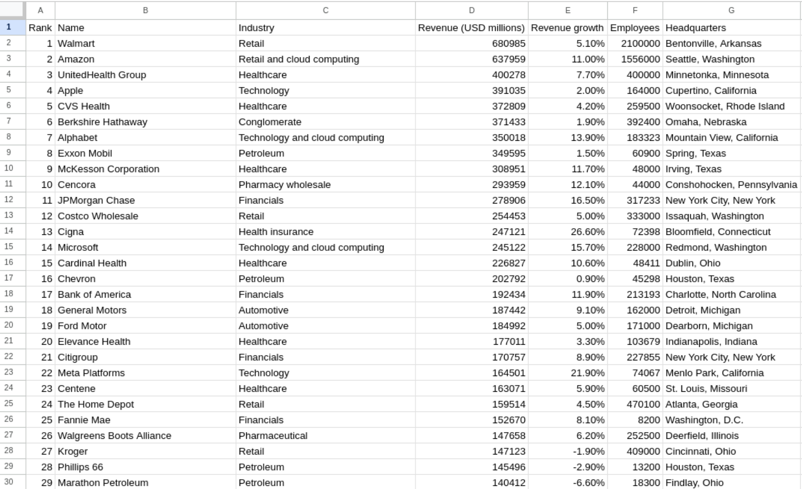
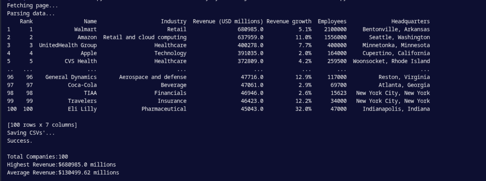

# Web Data Extractor – Top USA Companies

## 📌 Project Overview

A Python automation tool that scrapes real-world company data from Wikipedia 
and delivers a clean, structured CSV ready for analysis or reporting.

Extracts company name, rank, revenue, and industry — automatically cleaned 
and formatted using pandas. No manual copy-paste. Just run and get data.

---

## ⚙️ Features

* Scrapes real-world data from a website
* Extracts table data (company, revenue, rank, etc.)
* Cleans and structures the data using pandas
* Exports data to CSV format
* Clear error messages if the page can't be fetched or the table layout changes
* Strips Wikipedia footnote markers (like `[a]`) before converting numbers

---

## 🛠️ Tech Stack

* Python
* requests
* BeautifulSoup (bs4)
* pandas

---

## 📁 Project Structure

```
Web-Data-Extractor/
│
├── scraper/
│   ├── fetch_page.py          # downloads the Wikipedia page (requests)
│   └── parse_data.py          # finds the table, strips footnotes, builds the DataFrame
│
├── data/
│   ├── Top_USA_Companies.csv  # full cleaned table (100 companies)
│   └── Top_10_Companies.csv   # first 10 rows
│
├── screenshots/
│   ├── csv_preview.png
│   └── terminal_output.png
│
├── main.py                    # entry point: fetch, parse, clean numbers, save CSVs
├── .gitignore
├── LICENSE
├── requirements.txt
└── README.md
```

---

## 🚀 How to Run

1. Clone the repository
2. Install dependencies:

```
pip install -r requirements.txt
```

3. Run the script:

```
python main.py
```

---

## 📂 Output

The extracted data is saved in two files:

```
data/Top_USA_Companies.csv   # full cleaned table
data/Top_10_Companies.csv    # first 10 rows
```

Example outputs:

1.


2.


---

## ⚠️ Note

Always verify a website's robots.txt and terms of service before scraping in production.
